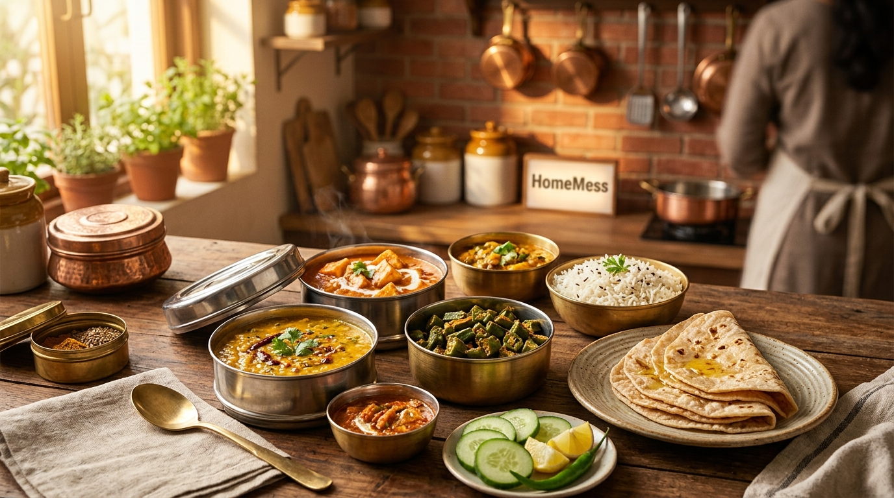
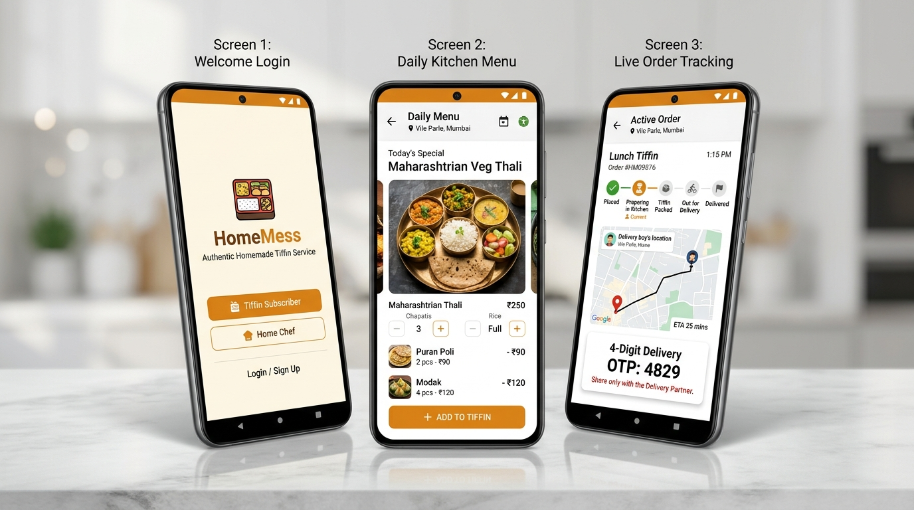
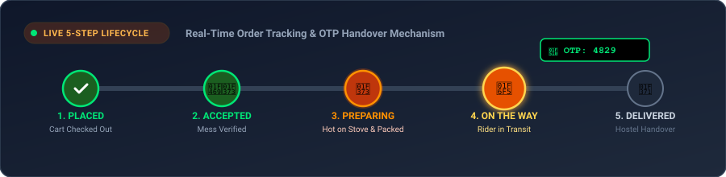
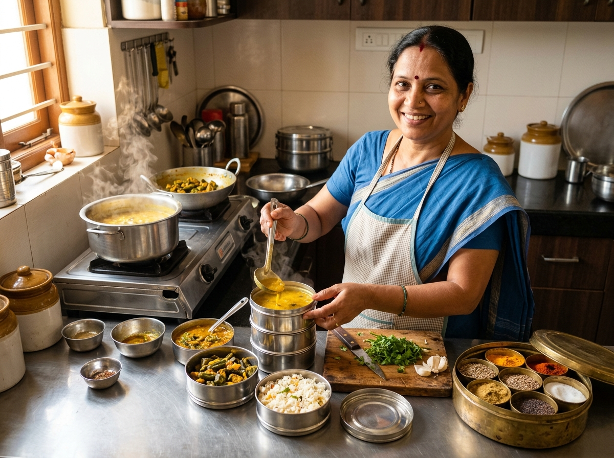
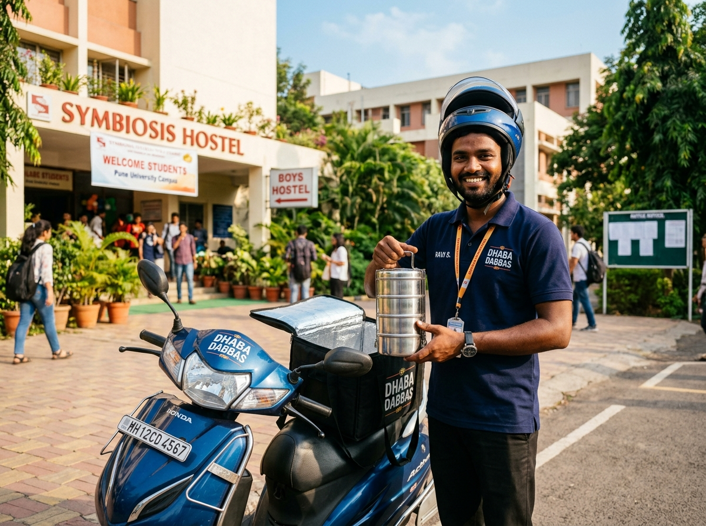
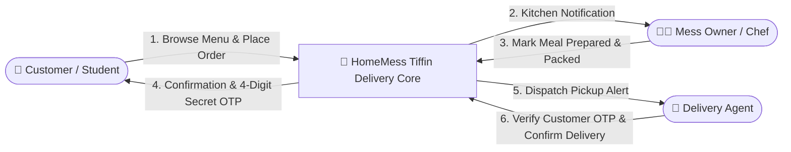

# 🍱 HomeMess — Homemade Tiffin Service Android App
### 🥣 From Warm Home Kitchens to Student Desks • Pure, Fresh & Punctual Dabba Delivery
<p align="center">
  
</p>
<p align="center">
  
</p>

<p align="center">
  <a href="#-project-identity--academic-credentials"></a>
  <a href="#-android-studio-technical-stack"></a>
  <a href="#-sqlite-database-architecture--schema"></a>
  <a href="#-three-core-ecosystem-roles"></a>
  <a href="#-1-click-quick-testing-credentials"></a>
</p>

---

## 🍛 What is HomeMess? (The Warm Story Behind the Name)

In the buzzing student neighborhoods of Pune — around **Tilak Road, Sadashiv Peth, Alka Talkies, and SP College** — thousands of college students and working professionals live far away from home. While fast-food apps deliver burgers and pizzas, nothing replaces the comfort of a **steaming stainless steel tiffin dabba** filled with hot chapatis, golden dal tadka, fresh seasonal vegetables, fragrant rice, and sweet shrikhand.

**HomeMess** was designed from the ground up to reflect the authentic atmosphere of an **Indian Home Mess (घरगुती खानावळ)**. It replaces disorganized telephone calls and paper registers with a **cozy, automated, and secure digital dining experience**:

* 🥣 **The "Little Bowls" (Katoris) Experience:** Every meal is organized just like a traditional Maharashtrian brass thali — distinct little katoris for dal, sukhi bhaji, amti, and dessert.
* 👩‍🍳 **The Warm Kitchen Direct to You:** Connects local home chefs with hungry students, offering daily fresh-cooked meal transparency.
* 🛵 **Safe & Punctual Delivery:** 5-step live order progression tracked from the kitchen stove to your hostel room.
* 🔐 **Confidential 4-Digit Delivery OTP:** Zero mix-ups — food is released to riders and students exclusively upon verification.

---

## 📱 Mobile Application Experience (As Seen on Device)

<p align="center">
  
</p>

<table width="100%" align="center" border="0">
  <tr align="center">
    <td width="33%">
      <h4>📲 Screen 1: Welcome & Auth</h4>
      <p>Instant role selection with <b>1-Click Demo Logins</b> for Students, Mess Owners, and Delivery Riders.</p>
    </td>
    <td width="33%">
      <h4>🥣 Screen 2: Daily Kitchen Menu</h4>
      <p>Browse authentic tiffins, customize chapati counts and spice levels, and tap <code>+ ADD TO TIFFIN</code>.</p>
    </td>
    <td width="33%">
      <h4>🛵 Screen 3: Live Order & OTP</h4>
      <p>Track real-time 5-step preparation status and display your <b>Confidential 4-Digit Handover OTP</b>.</p>
    </td>
  </tr>
</table>

---

## 📌 Table of Contents
1. [🎓 Project Identity & Academic Credentials](#-project-identity--academic-credentials)
2. [🥣 The "Little Bowls" (Katoris) Daily Menu Showcase](#-the-little-bowls-katoris-daily-menu-showcase)
3. [🔄 The Kitchen-to-Doorstep Journey (Workflow)](#-the-kitchen-to-doorstep-journey-workflow)
4. [👥 Three Core Ecosystem Roles](#-three-core-ecosystem-roles)
   - [A. Student / Customer (The Hungry Diner)](#a-student--customer-the-hungry-diner)
   - [B. Mess Owner / Chef (The Culinary Heart)](#b-mess-owner--chef-the-culinary-heart)
   - [C. Delivery Rider (The Punctual Dabbawala)](#c-delivery-rider-the-punctual-dabbawala)
5. [📊 Visual System Data Flow Diagrams (DFDs)](#-visual-system-data-flow-diagrams-dfds)
6. [🚦 5-Step Order State Transition Machine](#-5-step-order-state-transition-machine)
7. [🗄️ SQLite Database Architecture & Schema](#️-sqlite-database-architecture--schema)
8. [🛠️ Android Studio Technical Stack](#️-android-studio-technical-stack)
9. [⚡ Android Native Telephony & Hardware Integration](#-android-native-telephony--hardware-integration)
10. [🚀 Step-by-Step Installation & Running Guide](#-step-by-step-installation--running-guide)
11. [🔑 1-Click Quick Testing Credentials](#-1-click-quick-testing-credentials)
12. [🌐 Instant Web Browser Preview](#-instant-web-browser-preview)

---

## 🎓 Project Identity & Academic Credentials

<table align="center" width="100%">
  <tr>
    <td width="15%" align="center">
      <h1>🏛️</h1>
    </td>
    <td>
      <b>Institution:</b> Sir Parashurambhau College (Autonomous), Tilak Road, Pune – 411 030<br>
      <b>Department:</b> Department of Computer Science<br>
      <b>Degree Program:</b> Master of Science in Computer Science — M.Sc. (Comp. Sci.) Part I, Sem II<br>
      <b>Project Title:</b> <i>TIFFIN SERVICE ANDROID APPLICATION (HOME MESS)</i><br>
      <b>Faculty Project Guide:</b> Miss Rutuja Mam<br>
      <b>Student Developers:</b>
      <ul>
        <li><b>Gaurav Kaluram Khaladkar</b> (Seat No: <code>34305</code>)</li>
        <li><b>Aditay Balasaheb More</b> (Seat No: <code>34302</code>)</li>
      </ul>
      <b>Target Platform:</b> Android Studio (Java 17, SDK 34) &amp; Client Production Environment
    </td>
  </tr>
</table>

---

## 🥣 The "Little Bowls" (Katoris) Daily Menu Showcase

Just like opening a freshly packed brass or steel thali at home, the app breaks down wholesome meals into delectable little bowls (katoris):

<p align="center">
  
</p>
<p align="center">
  
</p>

### 🍲 Signature Daily Offerings

| Katori / Dish Name | Category | What's Inside the Little Bowls (Ingredients) | Spice Level | Price |
| :--- | :---: | :--- | :---: | :---: |
| **Special Maharashtrian Veg Thali** | 🍱 Thali | 3 Phulka Chapatis with ghee, Dal Tadka katori, Sukhi Batata Bhaji, Patal Bhaji, Steamed Basmati Rice, Gulab Jamun, Papad & Pickle | 🌶️ Medium | **₹120** |
| **Special Puran Poli Thali** | 🍯 Festive | 2 Puran Poli drenched in Desi Ghee, Katachi Amti bowl, Sukhi Bhaji, Rice, Lemon, and Chutney | 🌶️ Mild-Sweet | **₹160** |
| **Student Daily Budget Thali** | 🎓 Student | 3 Chapatis, Seasonal Sabzi of the day, Dal Fry bowl, Jeera Rice, Fresh Cucumber & Onion Salad | 🌶️ Regular | **₹80** |
| **Kolhapuri Chicken Tiffin** | 🍗 Non-Veg | Authentic Kolhapuri Chicken Curry katori, 3 Jowar Bhakris or Chapatis, Tambda Rassa bowl, Indrayani Rice, and refreshing Solkadhi | 🌶️🌶️ Spicy | **₹180** |
| **Kanda Poha & Masala Chai** | ☕ Breakfast | Steaming flattened rice tempered with mustard, roasted peanuts, curry leaves, grated fresh coconut, cilantro, and piping hot tea | 🌶️ Mild | **₹40** |
| **South Indian Idli Sambhar** | 🥥 Breakfast | 4 Soft steamed rice idlis served with piping hot vegetable sambhar and fresh wet coconut chutney | 🌶️ Mild | **₹50** |
| **High-Protein Sprouts & Paneer** | 🥗 Diet Bowl | Boiled sprouted green moong, diced cottage cheese paneer cubes, crisp salad, fresh lemon dressing, and chaat masala | 🌿 Healthy | **₹90** |

> [!TIP]
> **Customizable Portions:** Customers can dynamically adjust the number of chapatis (from 2 to 6), choose between Half/Full rice, and specify dietary instructions before confirming their cart.

---

## 🔄 The Kitchen-to-Doorstep Journey (Workflow)

<p align="center">
  
</p>

Here is how a mother's warm kitchen connects with a student's hostel desk in 5 seamless steps:

```
    [ 🧑‍🎓 STUDENT / CUSTOMER ]
              │
              ▼ (1. Browses delicious daily dishes in little katoris)
              ▼ (2. Adds meal to Cart, enters hostel address, chooses UPI or COD)
              │
         [ SQLite DB ] ──► (Generates Order #101 & Secret 4-Digit OTP e.g. 4829)
              │
              ▼ (3. Order pops up in Chef's live kitchen queue)
    [ 👩‍🍳 MESS OWNER / CHEF ]
              │
              ▼ (4. Chef clicks "Accept Order" ➔ "Send to Kitchen")
              ▼ (5. Packs tiffin into tiered steel dabbas; clicks "Ready for Rider")
              │
      [ Status: PREPARED ]
              │
              ▼ (6. Instant pickup notification broadcasts to delivery riders)
    [ 🛵 DELIVERY PARTNER ]
              │
              ▼ (7. Rider reaches mess, picks up warm dabba, clicks "Start Ride")
              ▼ (8. Customer's screen switches to live "Out for Delivery")
              ▼ (9. Rider arrives at student hostel)
              │
    [ 🤝 THE HANDOVER MOMENT ]
              │
              ▼ (10. Rider requests the 4-digit verification code)
              ▼ (11. Student provides on-screen secret OTP: 4829)
              ▼ (12. Rider inputs OTP into Rider App; native SQLite validates code)
              │
    [ 🏆 Status: DELIVERED ] ──► (Hot meal handed over, trip logged into Rider Earnings!)
```

---

## 👥 Three Core Ecosystem Roles

<table width="100%" border="0">
  <tr>
    <td width="33%" valign="top">
      <div align="center">
        <h3>🧑‍🎓 1. Student / Customer</h3>
        <p><i>The Hungry Diner</i></p>
      </div>
      <ul>
        <li><b>Fast Registration:</b> Sign up with Pune area, hostel name, room number, and phone.</li>
        <li><b>Daily Menu Exploration:</b> Filter by Thali, Breakfast, Diet, or Non-Veg.</li>
        <li><b>Meal Customization:</b> Adjust chapati count, rice portion, and spice heat.</li>
        <li><b>Flexible Checkout:</b> Pay via UPI (Google Pay, PhonePe) or Cash on Delivery.</li>
        <li><b>Secret 4-Digit OTP:</b> Displayed securely until physical meal delivery.</li>
        <li><b>Direct Calling:</b> 1-tap call to the mess kitchen for meal queries.</li>
      </ul>
    </td>
    <td width="33%" valign="top">
      <div align="center">
        <h3>👩‍🍳 2. Mess Owner / Chef</h3>
        <p><i>The Culinary Heart</i></p>
      </div>
      <ul>
        <li><b>Live Kitchen Dashboard:</b> Real-time pipeline of incoming tiffin requests.</li>
        <li><b>Post New Dishes:</b> Snap photos of freshly prepared food and post daily pricing &amp; quantity.</li>
        <li><b>Order Dispatch:</b> Move meals through <i>Accept</i> ➔ <i>Send to Kitchen</i> ➔ <i>Ready for Rider</i>.</li>
        <li><b>Daily Capacity Counter:</b> Automatic countdown of available tiffins.</li>
        <li><b>Customer Support:</b> Instant dialer to reach students for address clarifications.</li>
      </ul>
    </td>
    <td width="33%" valign="top">
      <div align="center">
        <h3>🛵 3. Delivery Rider</h3>
        <p><i>The Punctual Dabbawala</i></p>
      </div>
      <ul>
        <li><b>Pickup Queue:</b> View nearby messes with prepared tiffins ready to go.</li>
        <li><b>Trip Acceptance:</b> Tap <i>Accept &amp; Start Ride</i> to activate delivery transit.</li>
        <li><b>Student Contact:</b> One-tap phone dialer when arriving at hostel gates.</li>
        <li><b>OTP Verification:</b> Safe numeric validation to release the meal.</li>
        <li><b>Daily Earnings:</b> Automatic calculation of completed delivery trips.</li>
      </ul>
    </td>
  </tr>
</table>

<table width="100%">
  <tr>
    <td width="50%" align="center">
      <br>
      <sub><b>👩‍🍳 Inside the Home Mess Kitchen:</b> Freshly prepared food packed into stainless steel tiered dabbas.</sub>
    </td>
    <td width="50%" align="center">
      <br>
      <sub><b>🛵 Doorstep Handover:</b> Warm tiffin safely delivered outside student residence via OTP.</sub>
    </td>
  </tr>
</table>

---

## 📊 Visual System Data Flow Diagrams (DFDs)

### ❖ Level 0 DFD (System Context Architecture)



### ❖ Level 1 DFD (Subsystem Process Decomposition)

```mermaid
graph TD
    A[Student Submits Order] --> B[(1.0 Order Capture & OTP Generation)]
    B -->|Save Record & Generate 4-Digit OTP| DB[(SQLite Local Database)]
    B -->|Alert Kitchen Screen| C[(2.0 Kitchen Food Preparation)]
    C -->|Chef Marks "Ready for Rider"| D[(3.0 Prepared Pickup Queue)]
    D -->|Rider Taps "Accept & Start Ride"| E[(4.0 Out for Delivery Transit)]
    E -->|Rider Inputs Student OTP| F[(5.0 OTP Handover Verification)]
    F -->|Order Marked Complete| DB
    F -->|Customer Submits Star Review| G[Feedback & Ratings Archive]
```

---

## 🚦 5-Step Order State Transition Machine

<p align="center">
  
</p>

Every order advances systematically through five well-defined lifecycle states:

| Phase | State Constant | Actor Responsible | What Happens Behind the Scenes? | Student Visual Indicator |
| :---: | :--- | :---: | :--- | :--- |
| **1** | `PLACED` | Student | Order inserted into SQLite; unique 4-digit OTP created. | Step 1 active; OTP card appears on screen. |
| **2** | `ACCEPTED` | Mess Owner | Mess operator reviews meal list and confirms capacity. | Step 2 turns green: *"Mess Accepted Order"*. |
| **3** | `PREPARING` | Mess Owner | Meal is cooking on stove and getting packed into steel dabbas. | Step 3 pulses: *"Preparing in Kitchen"*. |
| **4** | `OUT_FOR_DELIVERY` | Rider | Delivery rider picks up the dabba and starts navigation. | Step 4 activates: *"Out for Delivery with Rider"*. |
| **5** | `DELIVERED` | Rider (via OTP) | Rider inputs the 4-digit OTP; database authenticates and closes. | Step 5 turns solid green: *"Delivered! Enjoy your meal"*. |

---

## 🗄️ SQLite Database Architecture & Schema

Persistent storage is completely contained on-device using Android's native `SQLiteOpenHelper` via `DatabaseHelper.java`. The schema maintains relational integrity across four primary tables:

```
  ┌─────────────────────────────────────────────────────────────────────────────┐
  │                         HOMEMESS SQLITE DATABASE                            │
  └───────┬─────────────────────┬─────────────────────┬──────────────────┬──────┘
          │                     │                     │                  │
          ▼                     ▼                     ▼                  ▼
    ┌───────────┐         ┌───────────┐         ┌───────────┐      ┌───────────┐
    │   users   │         │  dishes   │         │  orders   │      │ feedback  │
    └───────────┘         └───────────┘         └───────────┘      └───────────┘
```

### 1. `users` Table (Authentication & User Roles)
```sql
CREATE TABLE users (
    id INTEGER PRIMARY KEY AUTOINCREMENT,
    name TEXT NOT NULL,
    email TEXT UNIQUE NOT NULL,
    phone TEXT NOT NULL,
    password TEXT NOT NULL,
    role TEXT CHECK(role IN ('customer', 'chef', 'delivery')),
    address TEXT,
    area TEXT,
    pincode TEXT,
    city TEXT DEFAULT 'Pune'
);
```

### 2. `dishes` Table (Daily Tiffin Menu & Inventory)
```sql
CREATE TABLE dishes (
    id INTEGER PRIMARY KEY AUTOINCREMENT,
    mess_id INTEGER DEFAULT 1,
    dish_name TEXT NOT NULL,
    description TEXT,
    category TEXT CHECK(category IN ('Thali', 'Breakfast', 'Special', 'Non-Veg', 'Diet')),
    price REAL NOT NULL,
    quantity INTEGER DEFAULT 50,
    image_url TEXT,
    is_available INTEGER DEFAULT 1
);
```

### 3. `orders` Table (Transaction & OTP Fulfillment)
```sql
CREATE TABLE orders (
    id INTEGER PRIMARY KEY AUTOINCREMENT,
    customer_id INTEGER,
    customer_name TEXT,
    customer_phone TEXT,
    delivery_address TEXT,
    items_json TEXT,           -- Serialized JSON array of ordered katoris & items
    total_price REAL,
    status TEXT DEFAULT 'PLACED',
    payment_mode TEXT,         -- 'UPI (GPay/PhonePe)' or 'Cash on Delivery'
    order_date TEXT,
    agent_id INTEGER DEFAULT 0,
    otp TEXT NOT NULL          -- 4-Digit secret delivery confirmation code
);
```

### 4. `feedback` Table (Reviews & Star Ratings)
```sql
CREATE TABLE feedback (
    id INTEGER PRIMARY KEY AUTOINCREMENT,
    order_id INTEGER,
    user_name TEXT,
    rating INTEGER CHECK(rating BETWEEN 1 AND 5),
    comment TEXT,
    feedback_date TEXT
);
```

---

## 🛠️ Android Studio Technical Stack

```
HomeMess-Tiffin-Android/
├── app/
│   ├── build.gradle                   <-- compileSdk 34, minSdk 24, Java 17, Material Components
│   ├── src/main/
│   │   ├── AndroidManifest.xml        <-- Hardware Telephony, Camera, Haptic, & Internet permissions
│   │   ├── java/com/homemess/tiffinservice/
│   │   │   ├── SplashActivity.java    <-- SP College branded launch animation
│   │   │   ├── MainActivity.java      <-- Hardware-accelerated WebView container & native bridge
│   │   │   ├── bridge/
│   │   │   │   └── WebAppInterface.java <-- Bidirectional Java-to-JavaScript secure bridge
│   │   │   ├── db/
│   │   │   │   └── DatabaseHelper.java <-- SQLite schemas, sample seed records & CRUD operations
│   │   │   ├── model/
│   │   │   │   ├── Dish.java          <-- Tiffin meal entity
│   │   │   │   ├── Order.java         <-- Transaction & OTP entity
│   │   │   │   ├── User.java          <-- Account authentication entity
│   │   │   │   └── Feedback.java      <-- Star rating entity
│   │   │   └── util/
│   │   │       ├── Constants.java     <-- Shared constant definitions
│   │   │       └── PrefsHelper.java   <-- SharedPreferences session token wrapper
│   │   ├── res/
│   │   │   ├── layout/
│   │   │   │   ├── activity_main.xml  <-- Primary native activity viewport
│   │   │   │   └── activity_splash.xml<-- Introductory branded splash layout
│   │   │   └── values/
│   │   │       ├── colors.xml         <-- Saffron/Marigold palette (#e65100, #bf360c)
│   │   │       ├── strings.xml        <-- Localized application titles
│   │   │       └── themes.xml         <-- Material3 edge-to-edge window styling
│   │   └── assets/www/                <-- Ultra-fast client-side responsive application
│   │       ├── index.html             <-- Single-page UI containing all three operational views
│   │       ├── css/style.css          <-- Warm kitchen card design, stepper animations & badges
│   │       └── js/app.js              <-- State engine, shopping cart, bridge invocations
├── docs/images/                       <-- High-resolution culinary banners, thalis, & UI graphics
├── build.gradle                       <-- Root project gradle configuration
├── settings.gradle                    <-- Module management
├── gradlew                            <-- Unix wrapper script
└── gradlew.bat                        <-- Windows wrapper batch file
```

---

## ⚡ Android Native Telephony & Hardware Integration

The application interfaces directly with physical Android device features through the `WebAppInterface.java` bridge:

```java
// Java Bridge Example from WebAppInterface.java
@JavascriptInterface
public void makePhoneCall(String phoneNumber) {
    Intent intent = new Intent(Intent.ACTION_DIAL);
    intent.setData(Uri.parse("tel:" + phoneNumber));
    mContext.startActivity(intent);
}

@JavascriptInterface
public void vibrateDevice(long milliseconds) {
    Vibrator v = (Vibrator) mContext.getSystemService(Context.VIBRATOR_SERVICE);
    if (v != null && v.hasVibrator()) {
        v.vibrate(VibrationEffect.createOneShot(milliseconds, VibrationEffect.DEFAULT_AMPLITUDE));
    }
}
```

* 📞 **Direct Telephony Dialer (`CALL_PHONE`):** Tapping the mess contact or customer number launches Android's phone app with the recipient number pre-dialed.
* 📳 **Haptic Feedback Motor (`VIBRATE`):** Subtle physical vibration confirms cart additions, order submissions, and successful OTP handovers.
* 📷 **Camera Sensor (`CAMERA`):** Chefs can photograph freshly prepared thalis on the kitchen counter to upload into the live daily menu.
* 💳 **UPI Deep-Linking:** Automatically dispatches Google Pay, PhonePe, and Paytm payment intent handles for fast checkout.

---

## 🚀 Step-by-Step Installation & Running Guide

### Prerequisites
* **Android Studio:** Hedgehog (2023.1.1), Iguana, Jellyfish, or newer.
* **JDK:** Java Development Kit 17 (pre-bundled with Android Studio).
* **Target Emulator/Device:** Android 7.0 (Nougat, API 24) up to Android 14 (Upside Down Cake, API 34).

### Running in 3 Easy Steps:
1. **Open Android Studio:**  
   Click `File` ➔ `Open...` and navigate to:  
   `c:\Users\hp\.gemini\antigravity-ide\scratch\HomeMess-Tiffin-Android`
2. **Sync Gradle:**  
   Allow Gradle to synchronize dependencies. When prompted, select Java 17 as the Gradle JDK.
3. **Hit Run ▶ (or `Shift + F10`):**  
   Select your connected physical smartphone (with USB debugging enabled) or virtual emulator (e.g. Pixel 7 running API 34). The app will compile, install, and open with the branded splash screen!

---

## 🔑 1-Click Quick Testing Credentials

To make testing, evaluation, and grading effortless, the login screen includes **1-Click Demo Buttons** right at the top. Tap any button to instantly populate credentials and explore that role:

| Target Role | Demo Email Address | Demo Password | Recommended Testing Flow |
| :--- | :--- | :---: | :--- |
| **🧑‍🎓 Student / Customer** | `customer@gmail.com` | `pass123` | Browse Maharashtrian Thalis, customize chapatis, add to cart, choose COD or UPI, place order, and note down the **4-digit secret OTP**. |
| **👩‍🍳 Mess Owner / Chef** | `chef@gmail.com` | `pass123` | Check *"Orders to be Prepared"*, accept the student's order, click *"Send to Kitchen"*, and click *"Ready for Rider"*. |
| **🛵 Delivery Rider** | `delivery@gmail.com` | `pass123` | Accept the ready tiffin, view customer address, input the student's **4-digit OTP**, and verify the delivery! |

---

## 🌐 Instant Web Browser Preview

Want to test the full culinary UI flow on your computer without launching Android Studio? Open the HTML entrypoint in Google Chrome:

👉 [`app/src/main/assets/www/index.html`](file:///C:/Users/hp/.gemini/antigravity-ide/scratch/HomeMess-Tiffin-Android/app/src/main/assets/www/index.html)

*(In desktop browser mode, Android-native hardware features like haptic vibration and telephony fallback gracefully to onscreen alerts).*

---

## 👨‍💻 Project Authors & Department Credits

<div align="center">
  <p><b>Department of Computer Science</b><br>
  <b>Sir Parashurambhau College (Autonomous), Tilak Road, Pune – 411 030</b></p>
  
  <p>
    <b>Lead Developers:</b><br>
    🍱 <b>Gaurav Kaluram Khaladkar</b> (Seat No: <code>34305</code>) &nbsp;|&nbsp; 
    🍱 <b>Aditay Balasaheb More</b> (Seat No: <code>34302</code>)
  </p>

  <p>
    <b>Academic Project Guide:</b> Miss Rutuja Mam
  </p>
  
  <p><sub>Built with pride for Pune's student and home mess community • 2026</sub></p>
</div>
